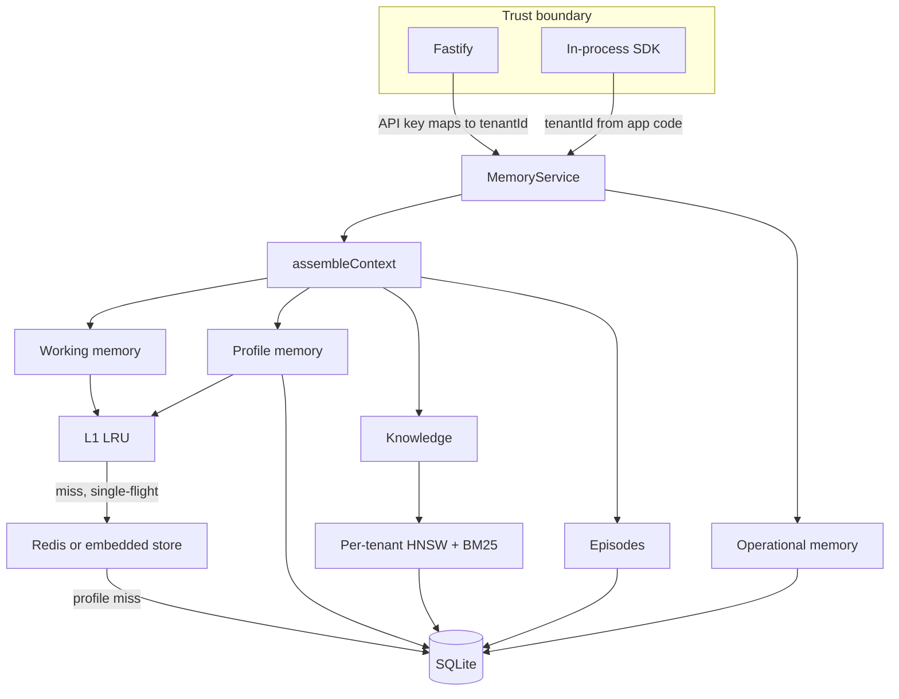

# Memlayer

Multi-tenant memory for an enterprise chatbot. Five layers, one TypeScript service, a hot path that stays in process when the session is warm.

Working memory and profile facts are read from a small in-process LRU, then a Redis-compatible store (embedded by default, ioredis when `REDIS_URL` is set). Profile facts, episodes, the audit log, and knowledge metadata live in SQLite. Knowledge search uses a **separate HNSW + BM25 index per tenant**, so another tenant's vectors are never scored.

No cloud API key is required. `pnpm test` and `pnpm bench` run offline.

## Architecture



`assembleContext` builds a token-budgeted pack for the model: newest working turns, profile facts, top-k knowledge, and recent episodes. Operational memory (audit, spend caps, kill switch) stays out of that pack unless `includeOperational: true`.

## Layers and stores

| Layer | What it holds | Hot path | Durable store | In the model prompt |
| --- | --- | --- | --- | --- |
| Working | Recent turns and tool results for a session | L1, then Redis (`ml:wm:{tenant}:{session}`, MessagePack, TTL) | Redis only. Sessions are ephemeral. | Yes, newest turns that fit |
| Profile | Small typed facts per user | L1, then Redis (`ml:pf:{tenant}:{user}`) | SQLite `profile_facts`. Writes delete the Redis key first, then commit SQLite, then fill Redis. | Yes, within ~15% of the budget |
| Knowledge | Document chunks | In-process HNSW + BM25 for that tenant only | SQLite `documents` + `chunks` (float32 blobs) | Top-k when a query is passed |
| Episodic | Decisions, resolved tickets, other events | SQLite by tenant, user, time | SQLite `episodes` | A few recent episodes |
| Operational | Append-only tool audit, step/spend caps, kill switch | Point reads on the caps primary key | SQLite `audit_log`, `control_caps`, `kill_switches` | Only when asked |

Token estimates use `ceil(chars / 4)`. That is a budget, not a tokenizer.

## Multi-tenancy

Every SDK call takes `tenantId`. On the HTTP server that value is **not** the one in the JSON body.

1. The client sends `X-Api-Key` or `Authorization: Bearer`.
2. The server hashes the key and maps it to a tenant (`API_KEYS=key:tenant,...`).
3. Handlers pass that tenant into the SDK.
4. If the body or query also sends `tenantId` and it differs, the response is `403 tenant_mismatch`.

The example chatbot in `examples/chat-bot.ts` is the app server: it passes `acme` itself. The mock model only sees the context pack.

Knowledge indexes are partitioned by tenant. Search loads one map entry. A missing `WHERE tenant_id` cannot leak rows that were never inserted into that index. ACL inside a tenant is `visibility: tenant` or `restricted` with `userIds` / `roles`.

## Latency targets

These are design targets for a warm local process, not a hosted SLA.

| Call | Target |
| --- | --- |
| `getWorkingMemory` L1 hit | p99 under 1 ms |
| `appendTurn` | p99 under 2 ms |
| `getProfile` L1 hit | p99 under 1 ms |
| `searchKnowledge` on about 60 local chunks | p99 under 5 ms |

`pnpm bench` prints ops/sec, p50, and p99 for `getSession` (the working-memory read), `appendTurn`, `getProfile`, and `searchKnowledge`.

One local run on Node v22.14.0 with the embedded Redis store, SQLite, the hashing embedder, and 60 chunks. `getSession` and `getProfile` are L1 hits after warmup. This is a measurement from this workspace, not a hosted SLA.

| op | ops/sec | p50 | p99 | samples |
| --- | ---: | ---: | ---: | ---: |
| getSession | 588,231 | 0.0012 ms | 0.0032 ms | 4000 |
| appendTurn | 22,078 | 0.0400 ms | 0.0796 ms | 2000 |
| getProfile | 1,081,016 | 0.0007 ms | 0.0012 ms | 4000 |
| searchKnowledge | 10,568 | 0.0766 ms | 0.3024 ms | 400 |

## Run locally

Node 20+ and pnpm.

```bash
pnpm install
pnpm test
pnpm bench
pnpm example
pnpm dev
```

The dev server listens on `http://127.0.0.1:43123` unless `PORT` / `HOST` say otherwise. With no `.env`, it uses the placeholder keys in `.env.example` and a SQLite file at `data/memlayer.sqlite`. Copy `.env.example` to `.env` to change them. Open `http://127.0.0.1:43123/showcase` for a live walk through the five layers.

```bash
curl -s http://127.0.0.1:43123/health
curl -s -X PUT http://127.0.0.1:43123/v1/users/u_ada/facts/plan \
  -H 'content-type: application/json' \
  -H 'x-api-key: dev_acme_key' \
  -d '{"type":"string","value":"enterprise"}'
curl -s -X POST http://127.0.0.1:43123/v1/context \
  -H 'content-type: application/json' \
  -H 'x-api-key: dev_acme_key' \
  -d '{"userId":"u_ada","sessionId":"s1","query":"refund window"}'
```

## Docker

Tests do not need Docker. To run Memlayer itself in Docker, with Redis as the hot-path store and SQLite on a volume:

```bash
docker compose up -d --build
```

The API is on `http://127.0.0.1:43123`. The layer walkthrough is `http://127.0.0.1:43123/showcase`. Placeholder keys are `dev_acme_key` (tenant `acme`) and `dev_globex_key` (tenant `globex`). Compose sets `HOST=0.0.0.0` and uses the host network: Redis is `127.0.0.1:6379` (bound to localhost) and Memlayer is `127.0.0.1:43123`.

[TrueForge](https://github.com/truefoundry/trueforge) is a separate agent harness. This repo runs the published standalone server (`@truefoundry/trueforge`, SQLite, no Redis) beside Memlayer. It does not call Memlayer; the showcase is the place that shows how Memlayer's layers are filled and assembled.

```bash
docker compose -f deploy/trueforge/docker-compose.yml up -d --build
```

TrueForge listens on `http://127.0.0.1:8791`.

Compose already sets `REDIS_URL=redis://127.0.0.1:6379` for the Memlayer container. Redis is bound to localhost only. Leave `REDIS_URL` empty when you run `pnpm dev` on the host and want the embedded store instead.

The embedded store implements the same client surface as the pool: `GET`/`SET`/`DEL`, `MGET`, and `PIPELINE`. The ioredis adapter keeps a small connection pool (`REDIS_POOL_SIZE`, default 4) with auto-pipelining, and explicit pipelines still run on one connection. Concurrent misses for different keys in the same turn are coalesced into one pipeline. Concurrent misses for the **same** key share one in-flight load (single-flight) so SQLite is hit once.

L1 TTL defaults to 500 ms and refreshes on read. That is long enough for a chat turn and short enough that another process writing Redis is not stuck behind a stale process cache. Writes update L1 in this process immediately.

## HTTP API

All `/v1` routes require the API key. Tenant comes only from that key.

| Method | Path | SDK |
| --- | --- | --- |
| `POST` | `/v1/sessions/:sessionId/turns` | `appendTurn` |
| `GET` | `/v1/sessions/:sessionId/memory` | `getWorkingMemory` |
| `DELETE` | `/v1/sessions/:sessionId` | `clearSession` |
| `PUT` | `/v1/users/:userId/facts/:key` | `setProfileFact` |
| `GET` | `/v1/users/:userId/profile` | `getProfile` |
| `DELETE` | `/v1/users/:userId/facts/:key` | `forgetFact` |
| `POST` | `/v1/knowledge/documents` | `ingestDocument` |
| `POST` | `/v1/knowledge/search` | `searchKnowledge` |
| `POST` | `/v1/episodes` | `recordEpisode` |
| `GET` | `/v1/episodes` | `listEpisodes` |
| `POST` | `/v1/audit` | `recordAudit` |
| `GET` | `/v1/audit` | `listAudit` |
| `GET` | `/v1/caps` | `getCaps` |
| `PUT` | `/v1/caps` | `setCaps` |
| `PUT` | `/v1/kill-switch` | `setKillSwitch` |
| `POST` | `/v1/context` | `assembleContext` |

Errors are `{ error: { code, message } }` with codes such as `validation`, `unauthorized`, `tenant_mismatch`, `not_found`, `kill_switch`, `cap_exceeded`, and `timeout`.

`recordAudit` appends a row, then increments step and spend counters for the tenant and, when present, the user and session. A kill switch or a cap writes a `kill_switch_blocked` or `cap_exceeded` row and does not increment usage.

## SDK sketch

```ts
import { openMemoryService } from './src/index.ts';

const memory = await openMemoryService({ databasePath: 'data/memlayer.sqlite' });
const pack = await memory.assembleContext('acme', 'u_ada', 's1', 'refund window');
// pack.prompt is what you send to the model. pack.operational is absent.
```

This repo runs TypeScript in place via `tsx`. Import from `./src/index.ts` inside the repo (see `examples/chat-bot.ts`).

## Swapping stores

**Redis.** Set `REDIS_URL`. Leave it empty to keep the in-memory implementation. The `RedisClient` interface is the seam (`src/redis/client.ts`).

**Embeddings.** Pass `embeddings` to `openMemoryService`. `HashEmbeddingProvider` is a signed feature hasher (`hashing-trick-v1`) so search works offline. A hosted embedder implements `EmbeddingProvider` and may return promises. The database records `embedding_id` and `embedding_dim` and refuses to open if they change; start a new SQLite file when you change models. Hybrid rank is `0.35 * cosine + 0.65 * squashed BM25`. Scores are absolute, not min-maxed inside the candidate set, so a tenant with one chunk does not match every query. A hit with no keyword overlap is kept only when cosine is at least 0.42. That keeps keyword recall useful while the hasher is in place.

**Vectors.** `HnswIndex` is an in-process HNSW graph. `KnowledgeEngine` builds one graph and one BM25 index per tenant and reloads them from SQLite chunk blobs on startup. To move to pgvector or Qdrant:

1. Keep `documents` / `chunks` as the source of truth (or the equivalent Postgres tables).
2. Replace `KnowledgeEngine.search` / `addRow` with a filtered ANN query whose **first predicate is `tenant_id = $authenticatedTenant`**.
3. Leave ACL as a second predicate (`visibility`, `user_ids`, `roles`).
4. Keep the `EmbeddingProvider` you already inject.

SQLite tables map directly: `profile_facts`, `documents`, `chunks`, `episodes`, `audit_log`, `control_caps`, `kill_switches`. Compose does not start Postgres. A future adapter would bring its own database.

**Durable SQL.** `DurableStore` is the only SQLite caller. A Postgres implementation of the same methods can sit behind it. Use `pgvector` in `chunks.vector` if you want the ANN next to the metadata.

## License

MIT. See [LICENSE](LICENSE).
